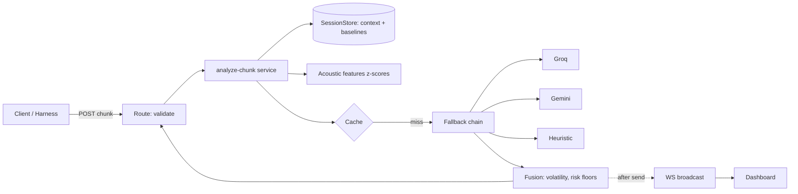

# Evidence-based docs

## Golden rule
Every number, metric, failure story or "we chose X because Y" links to its source:
`reports/*.md`, `specs/adr/*.md`, `.agent-work/ai-log.md`, `.agent-work/reviews/*`, `package.json`.
Missing evidence → `TODO(evidence): <what to run>` — never fill the gap.

## ARCHITECTURE.md skeleton (order mirrors the brief)
1. Overview (3 sentences) + Mermaid diagram:

2. LLM provider choice — table: provider, model, p50/p95 (from bench), macro-F1 (from eval), free-tier limit, why
3. Streaming & concurrency — per-session snapshot, no lock, ordering by timestamp, post-send commits, in-flight cap
4. Sarcasm & hidden intent — taxonomy, context window, speaker baselines, contrastive few-shots, LLM-semantics/code-math split
5. **How quality was checked** — dataset design, coverage, split, results table (ours vs reference), what it showed incl. weak classes
6. Known limitations · 7. With more time

## AI_COLLABORATION.md skeleton
1. Tools & roles (agent roster table: agent, model, tools, lane)
2. Workflow (kickoff → slice → review → eval → audit → ship) + guardrails (hooks, permissions)
3. Most effective prompting patterns — 3–5, each with a short real excerpt
4. Where AI failed — real `ai-log` entries: what, detected by, fix
5. How AI output was validated — gates, reviewer verdict stats, eval, human checkpoints

## Style
Short sentences, tables over prose, no marketing words, trade-offs stated as "X at the cost of Y".
Verify every command shown exists in `package.json`.
