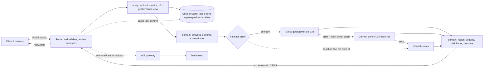

# Architecture

## 1. Overview
One Fastify process serves `POST /api/telemetry/stream`, `GET /health`, a session summary and `WS /ws/telemetry`. Each chunk goes through
a pure-TypeScript acoustic baseline, one LLM call (Groq, then Gemini on error, then a rule-based heuristic), and a deterministic fusion step
that owns volatility and risk floors. The API contract is frozen in [specs/SPEC.md](specs/SPEC.md) and enforced by zod in `packages/contracts`.

There is no verdict cache: it was cut at spec freeze because the safe cache key only hits on byte-identical replays ([ADR-004](specs/adr/004-concurrency-session-state.md)).

## 2. LLM provider choice
One OpenAI-compatible adapter (native `fetch`, keep-alive) is instantiated twice from env, so Groq, Gemini, Cerebras or Ollama are config
changes ([ADR-001](specs/adr/001-provider-strategy.md)). Output is JSON mode with compact keys and `max_tokens` 90, `temperature` 0.

| Candidate | Quality (tune, n 89) | Latency | Free-tier facts | Verdict |
|---|---|---|---|---|
| **Groq `qwen/qwen3.8-27b`, effort none** (primary) | macro-F1 0.77 on prompt v1.3 ([eval](reports/eval-s8a-v1.3.md)); 0.75 on v1.1 ([A/B](reports/ab-cp1.md)) | Eval-observed client p50 / p95 243 / 392 ms (v1.3, throttled, **not a bench**). `bench --quick` n 50 on v1.1 without context: 249 / 453 ms ([A/B](reports/ab-cp1.md)) | Org limit 8000 TPM (from a 429 body, [ADR-005](specs/adr/005-provider-amendment-cp1.md)); daily token quota (TPD) ran out in S8a ([R3](.agent-work/requests/eval-engineer-S8a.md)) | Chosen. Groq lists it as **Preview** |
| Groq `openai/gpt-oss-20b`, effort low | 0.33 | 85.4% of eval chunks answered by heuristic (timeouts + bad_json); bench invalid (429s, cause unexplained) | same org limits | Rejected: not viable at `max_tokens` 90 ([A/B](reports/ab-cp1.md)) |
| Groq `llama-3.1-8b-instant` (original pick) | not measured | not measured | 404 `model_not_found` on the project key | Dropped for this key ([ADR-005](specs/adr/005-provider-amendment-cp1.md)) |
| Gemini `gemini-3.5-flash-lite` (fallback) | not evaluated as primary | 580-1170 ms per call (8 calls, [ADR-005](specs/adr/005-provider-amendment-cp1.md)); p50 681 ms all calls, warm p50 660 / p95 852 ms (12 calls, [S4a handoff](.agent-work/handoff/backend-dev-S4a.md)) | Free-tier RPM/RPD UNVERIFIED ([ADR-001](specs/adr/001-provider-strategy.md)) | Fallback for fast primary errors only |

Trade-offs stated plainly:
- **Sequential fallback, no timer hedge** (human decision H2). A slow-but-alive Groq ends in the heuristic at the deadline, not in Gemini. Cost: quality on slow calls.
  Benefit: no speculative second call spending quota. In the v1.3 eval 3 of 89 chunks (3.4%) hit the deadline; Gemini answered none
  ([eval](reports/eval-s8a-v1.3.md), provider mix).
- **The deadline is counted from handler entry** (`LLM_DEADLINE_MS` 450, `AbortController`). A fallback started after an error gets only the remaining budget.
- **Gemini as primary would be mostly heuristic** at a 450 ms deadline (see SETUP, backlog T14).
- **The 450 ms deadline bounds p95 at the cost of quality**: deadline-timeout answers come from the heuristic (66.7% strict on those 3 chunks, n too small to mean anything).
- **Prompt size.** Groq-measured: 793 tokens with no context, 913 with 3 context turns ([changelog](reports/PROMPT_CHANGELOG.md)); the ≤ 550 system-prefix target was not reached.
  Trimming 51 tokens bought no measurable latency (Groq-answered p50 234 vs 239.5 ms), so the trim was rejected.

## 3. Streaming and concurrency ([ADR-004](specs/adr/004-concurrency-session-state.md))
- **No per-session lock** around the LLM call. `SessionStore.snapshot()` is synchronous and returns an immutable copy of the last `CONTEXT_TURNS` (3) turns plus baselines.
- **Ordered commit.** `commit()` runs in the same tick as `reply.send()`, inserting by `timestamp_ms` (ties keep arrival order), so out-of-order chunks are accepted.
- **Cost:** two chunks of one session arriving within one LLM round trip see the same context.
- **Fan-out is off the hot path.** The WS broadcast runs via `setImmediate` after the reply, only when `commit()` accepted the chunk. A client whose buffer exceeds 1 MB is dropped; max 50 clients (`WS_MAX_CLIENTS`).
- **In-flight cap** per provider (`LLM_MAX_INFLIGHT` 16); at the cap the provider is skipped like an open circuit breaker (3 failures, 15 s cooldown).
- **Bounds.** 1000 sessions (LRU), 30 min idle TTL, a hashed idempotency set per session. Duplicate `chunk_id`s are re-analysed but not re-committed.
- **Tests.** `session.concurrency-no-bleed` runs 20 sessions × 10 chunks in parallel and checks ids and state isolation (`apps/backend/test/pipeline-session.test.ts`). 245 tests / 27 files passed at the S8a-r1 reviewer run ([S8a-r1](.agent-work/reviews/S8a-r1.md)); not re-run for this document.
- **No 5xx from the LLM.** Any unexpected exception returns a heuristic result; the response is parsed by zod before sending and `hidden_intent` / `mitigation_suggestion` are truncated on a word boundary (60 / 120 chars).

## 4. Sarcasm and hidden-intent approach
Label rules live in one place, [`nuance-taxonomy`](.claude/skills/nuance-taxonomy/SKILL.md); the prompt, the eval labels and the spec all follow it.
No rule is derived from the brief's single example: the dataset contains that sentence pattern under different contexts and acoustics, with different labels.

| Layer | What it does | Where |
|---|---|---|
| Prompt | Static system prompt first (provider prefix caching), dynamic block last. 7 label definitions with "not when" hints, a tie-break order, 5 invented contrastive few-shots (sarcasm, deflection, veiled aggression, appeasement, genuine positive) | `apps/backend/src/llm/prompt.ts`, v1.3 |
| Context | Last 3 turns (each ≤ 40 words) as `[speaker\|sentiment] <<<text>>>`, so "Sounds great." can flip with the previous turn | [ADR-004](specs/adr/004-concurrency-session-state.md) |
| Acoustic baselines | Welford mean/std per `session_id × speaker`; population priors for a speaker's first 2 chunks; descriptors such as "pitch much higher than this speaker's norm" go in the prompt, not raw numbers. Missing acoustics become neutral defaults, flagged as imputed | [ADR-003](specs/adr/003-volatility-risk-fusion.md) |
| Fusion | Volatility `v = 0.4·|Δarousal_z| + 0.4·valence_shift + 0.2·pitch_volatility`, flag at `v ≥ 0.6`; risk floors (aggressive ≥ high, aggressive + volatility = critical, confident positive ≤ medium); confidence × 0.85 when delivery contradicts a positive/neutral text | `domain/` |
| Heuristic | Word-boundary rules, confidence capped at 0.6; last resort and no-key mode | `heuristics/` |
| Injection | Transcript is wrapped in `<<< >>>`, defanged (NFKC, control chars stripped, delimiters blanked), and the prompt says every such block is untrusted | `prompt.ts`; [audit r2](.agent-work/security/audit-r2.md) |

Acoustics never decide sentiment alone. They tune confidence, disambiguate and feed volatility. The LLM does not compute volatility or risk floors.
The volatility weights and threshold are priors; they have not been tuned (ADR-003: "priors, not measured").

## 5. How classification quality was checked
**Dataset** ([schema](apps/backend/eval/SCHEMA.md), [tune](apps/backend/eval/datasets/tune.jsonl), [holdout](apps/backend/eval/datasets/holdout.jsonl)).
117 self-authored chunks of B2B negotiation (SaaS renewal, procurement, pricing, legal, competitor bluff, deadline pressure, scope delivery, SLA).
Split **by session**: tune 89 chunks / 12 sessions, holdout 28 chunks / 3 sessions. Methodology rule ([eval-methodology](.claude/skills/eval-methodology/SKILL.md)): labels, `acceptable_sentiments` and a rationale are written before any model runs.
Volatility labels are human judgement, not formula output: a reviewer caught that formula-derived labels were circular ([ai-log](.agent-work/ai-log.md)).
A validator checks schema and fusion-floor consistency.

**Coverage** (tune, from [report](reports/eval-s8a-v1.3.md)):

| Label | positive | negative | neutral | sarcastic | aggressive | deflecting | appeasement |
|---|---|---|---|---|---|---|---|
| n (candidate + counterpart) | 14 | 13 | 26 | 8 | 7 | 9 | 12 |

Slices tagged in the data: acoustic agree (17) vs contradict (8), counterfactual pairs (same text, different acoustics, 8), context-flip pairs (same text,
different previous turn, 8), hard negatives such as genuine praise and polite firmness (18), injection (3), the brief's sentence pattern (3).

**Strict vs lenient.** Strict = predicted label equals the expected label. Lenient = predicted label is in `acceptable_sentiments`. Headline metric is **macro-F1** (7 classes).
**Wilson 95% intervals** are in each report; at n 89 they are wide (strict 77.5% [67.8%, 85.0%]).

### Results (tune split, n 89, same chunks for every column)

| Metric | Reference backend ([report](reports/eval-reference.md)) | Ours, heuristic ([report](reports/eval-latest.md)) | Ours, LLM, prompt v1.3 ([report](reports/eval-s8a-v1.3.md)) |
|---|---|---|---|
| Strict accuracy | 36.0% | 59.6% (fitted to tune) | 77.5% |
| Lenient accuracy | 51.7% | 69.7% | 95.5% |
| **Macro-F1** | 0.21 | 0.52 | **0.77** |
| Nuance subset strict / lenient (n 31) | 0.0% / 9.7% | 45.2% / 45.2% | 83.9% / 96.8% |
| Risk MAE (ordinal) / exact | 0.88 / 42.7% | 0.70 / 51.7% | 0.36 / 67.4% |
| Volatility detection F1 vs human labels | 0.80 | 0.57 | 0.73 |
| Volatility fusion fidelity vs oracle | 93.3% | 100.0% | 100.0% |
| Constant-`neutral` floor, strict / macro-F1 | 29.2% / 0.06 | same | same |

Per-class F1, LLM v1.3: positive 0.81, negative 0.64, neutral 0.74, **sarcastic 0.50**, aggressive 0.86, deflecting 0.82, appeasement 1.00.
Provider mix in that run: Groq 86 (96.6%), heuristic 3 (3.4%, all deadline timeouts), Gemini 0, 429s 0.

**What it showed, including weaknesses**
- The reference's labels collapse to neutral/positive/negative/aggressive; it scores F1 0.00 on negative, sarcastic, deflecting and appeasement. Ours covers all seven.
- **Sarcasm recall is 3/8.** Misses go to negative (2), positive, deflecting, aggressive. "Sounds great." after a complaint is still labelled positive. Only 1 of the 4 context-flip text pairs is strict-correct on both members, versus 3 of 4 counterfactual pairs ([eval](reports/eval-s8a-v1.3.md), Pairs table).
- **Offers and proposals drift to positive** (neutral → positive in 4 chunks) and neutral recall is 0.65.
- **Sudden-shift chunks** are 60% strict (n 5); `acoustic:contradict` is 62.5% strict but 100% lenient.
- **Confidence does not separate right from wrong**: mean 0.91 when correct, 0.86 when wrong. Do not use it as a calibrated probability.
- **Volatility detection** (F1 0.73) is below the reference's 0.80 on only 5 true positives (TP 4, FP 2, FN 1). The deterministic fusion matches its oracle exactly (fidelity 100%); the misses come from sentiment errors, formula limits and labeller noise.
- **Heuristic mode** has sarcastic F1 0.00 and aggressive recall 0.29. Its tune numbers were tuned against the tune failure table; a reviewer's non-official check showed holdout strict flat at 46.4% (n 28) while tune rose ([S4b-r2](.agent-work/reviews/S4b-r2.md)). Cite tune heuristic figures as fitted.
- **Prompt iteration (3 allowed, 2 run).** v1.4 (shorter prompt) was rejected: macro-F1 0.77 → 0.73, no latency gain. v1.5 (sarcasm definition) was invalid because the Groq daily quota ran out mid-run; v1.3 stays shipped. v1.5 is untested on a clean run ([changelog](reports/PROMPT_CHANGELOG.md)).

## 6. Known limitations
| Limitation | Evidence |
|---|---|
| **Holdout not run.** All LLM quality numbers are on the tune split that the prompt was iterated against | [changelog](reports/PROMPT_CHANGELOG.md): "Holdout was not run" |
| **No LLM-mode bench.** `reports/bench-latest.md` and `reports/eval-latest.md` are heuristic-mode runs. LLM latency evidence is the eval-time client p50/p95 (243 / 392 ms, throttled to 7 RPM) and the v1.1 quick bench (249 / 453 ms, n 50). The p50 budget is met nominally, by 7 ms | [eval](reports/eval-s8a-v1.3.md), [A/B](reports/ab-cp1.md) |
| **Groq free-tier daily token quota (TPD)** was exhausted during S8a; one iteration is invalid and a full LLM bench needs a fresh quota window | [R3](.agent-work/requests/eval-engineer-S8a.md) |
| Primary model is a Groq **Preview** model; evaluator keys may lack access or hit different limits | [ADR-005](specs/adr/005-provider-amendment-cp1.md) |
| Self-authored data, single labeller, small per-class n (7 to 26). Shares the author's blind spots. No second-labeller check was run | eval report "Limits" |
| Sarcasm recall 3/8 and the confusions in section 5 | [eval](reports/eval-s8a-v1.3.md) |
| Heuristic mode does not detect sarcasm (tune sarcastic F1 0.00); benign deferrals → deflecting/medium; tune figures are fitted to the tune failure table (holdout strict flat 46.4% while tune rose); `eval:smoke` threshold (9/15 lenient correct) equals the heuristic's current floor — treat it as a regression tripwire, not a quality bar | [eval-latest](reports/eval-latest.md), [S4b-r2](.agent-work/reviews/S4b-r2.md), TASKS T16 |
| Throttled eval: sessions ran at 7 RPM, so latency under real parallel load on a live LLM is unmeasured | [eval](reports/eval-s8a-v1.3.md) |
| Injection: unit probes of the defang step hold; the LLM chain has not been evaluated against the 7 security cases (the 3 in tune were all strict-correct) | [audit r2 S-04](.agent-work/security/audit-r2.md) |
| No auth, no rate limit; the WS broadcast is global to allowed origins; loopback bind by default | [audit r2](.agent-work/security/audit-r2.md) |
| Single process; state is in memory. Worst case about 1.10 GB for 1000 full sessions measured in the audit; no persistence | [audit r2 S-02](.agent-work/security/audit-r2.md), ADR-004 |
| Volatility weights are untuned priors | [ADR-003](specs/adr/003-volatility-risk-fusion.md) |
| Gemini-only keys are mostly heuristic at a 450 ms deadline | [ADR-005](specs/adr/005-provider-amendment-cp1.md) |

## 7. What I would do with more time
1. Re-run the v1.5 sarcasm definition on a fresh quota, then run the holdout **once** and report it; run the full LLM-mode bench (n 400) on the same prompt.
2. Log provider `usage` tokens per request ([request R1](.agent-work/requests/eval-engineer-S8a.md)) so throttles are sized from data, not from separate probes.
3. Test a smaller prompt (drop 2 few-shots) as a separate hypothesis; the current system prefix is about 750 tokens, above the 550 target.
4. Add a second labeller (a fresh-context pass) to bound achievable accuracy, and more sarcastic and context-flip cases (n 8 each is too few).
5. Tune volatility weights on the tune split only, with more than 5 true positives.
6. Cap LLM spend per client without breaking the contract (a 429 from our own API is outside the frozen error set; see [request](.agent-work/requests/contract-change-ratelimit.md)).
